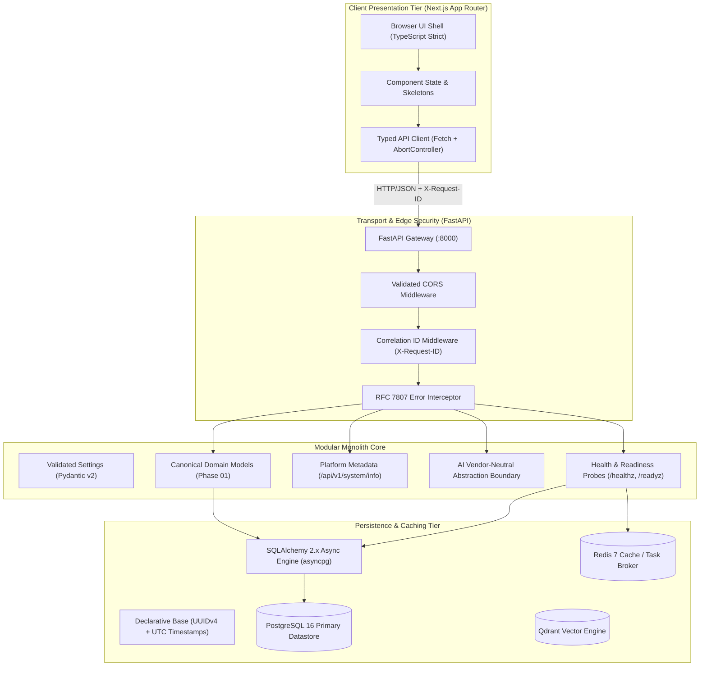
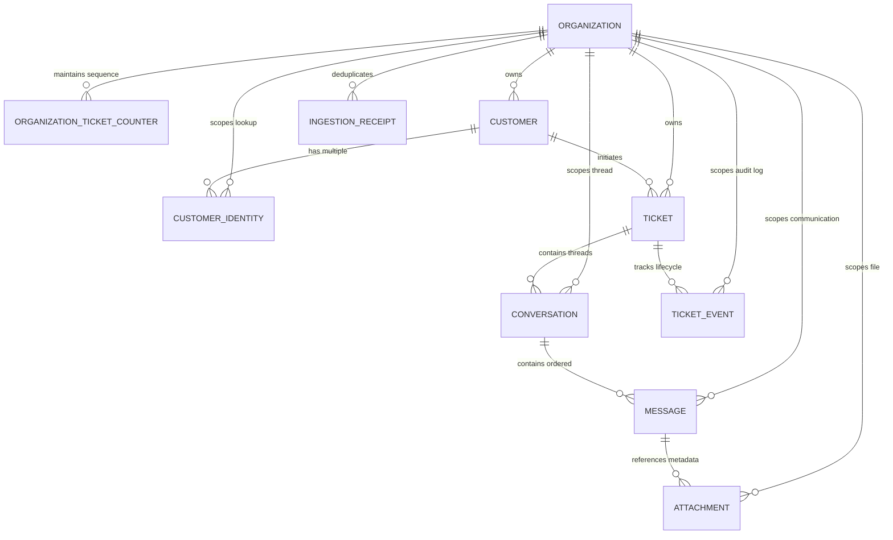
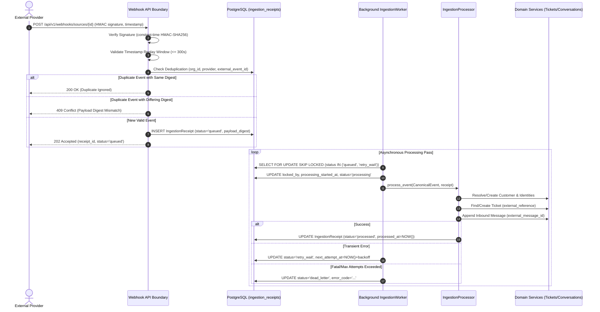
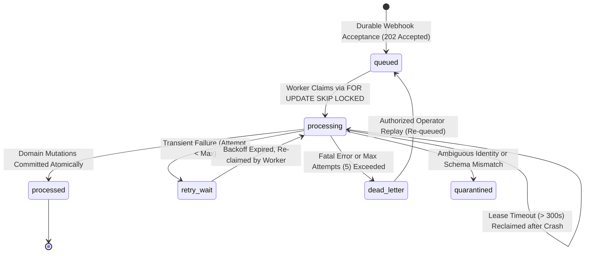
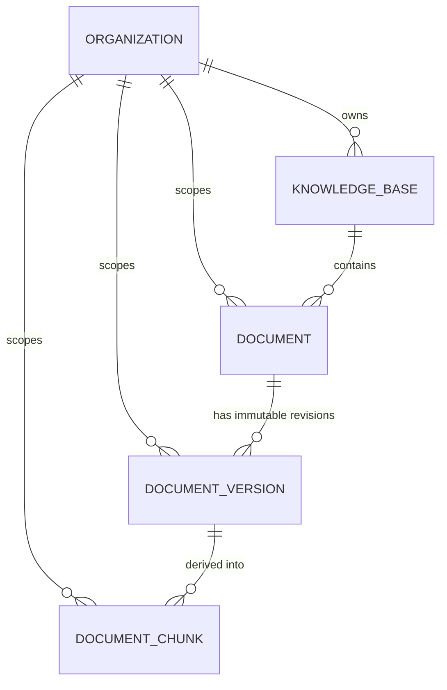
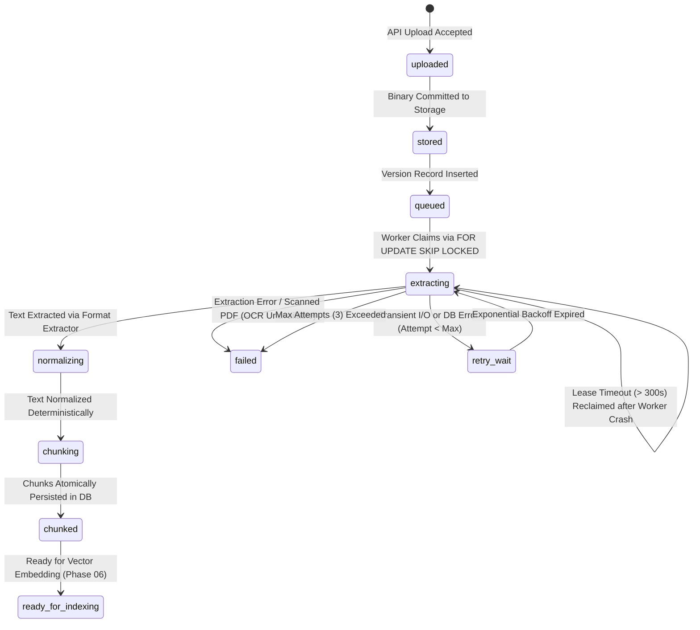
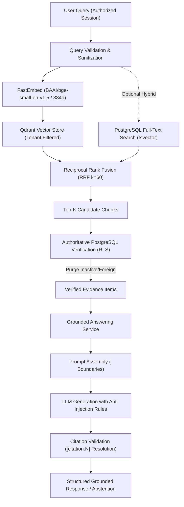

# SupportGPT AI — Architecture & Engineering Standards

## 1. System Mission & Scope
SupportGPT AI is an enterprise-grade multi-tenant B2B SaaS platform engineered for customer support automation with factual reliability, claim-level response verification, human-in-the-loop approvals, and forensic failure investigation.

Phase 00 established the greenfield technical foundation and architectural standards across the frontend, backend, database, and infrastructure tiers.
Phase 01 establishes the canonical customer support domain models, normalized schemas, composite tenant boundaries, and Alembic database migration foundation.

---

## 2. High-Level Architecture Diagram

---

## 3. Domain Model Architecture & Entity Relationship (Phase 01)

### 3.1 Domain Glossary
- **`Organization`**: Authoritative enterprise customer workspace and root multi-tenant boundary.
- **`OrganizationTicketCounter`**: Concurrency-safe atomic sequential counter table allocating per-organization ticket numbers.
- **`Customer`**: External person or business contacting customer support.
- **`CustomerIdentity`**: Specific contact handle (email, phone, channel identifier) owned by a customer, normalized for deduplication.
- **`Ticket`**: Canonical customer support case record tracking subject, lifecycle status, priority, and assignment.
- **`Conversation`**: Interactive communication thread within a ticket (e.g. email thread, live chat session).
- **`Message`**: Immutable individual communication entry within a conversation thread with deterministic chronological ordering.
- **`Attachment`**: Opaque file metadata reference attached to a message without storing file bytes in relational rows.
- **`TicketEvent`**: Append-only historical lifecycle audit record capturing state transitions, assignments, and mutations.
- **`IngestionReceipt`**: Inbound event idempotency record tracking external provider event IDs to prevent duplicate processing.

### 3.2 Entity Relationship Diagram

---

## 4. Key Integrity Rules & Database Invariants

### 4.1 Tenant-Boundary Composite Foreign Keys
To guarantee multi-tenant data consistency at the PostgreSQL engine level, child entities enforce composite foreign keys spanning both the parent ID and the `organization_id`:
1. `conversations` enforces `FOREIGN KEY (ticket_id, organization_id) REFERENCES tickets(id, organization_id)` on `RESTRICT`.
2. `messages` enforces `FOREIGN KEY (conversation_id, organization_id) REFERENCES conversations(id, organization_id)` on `RESTRICT`.
3. `attachments` enforces `FOREIGN KEY (message_id, organization_id) REFERENCES messages(id, organization_id)` on `RESTRICT`.
4. `ticket_events` enforces `FOREIGN KEY (ticket_id, organization_id) REFERENCES tickets(id, organization_id)` on `RESTRICT`.
5. `customer_identities` enforces `FOREIGN KEY (customer_id, organization_id) REFERENCES customers(id, organization_id)` on `CASCADE`.

**Impact**: It is physically impossible in the database for a conversation, message, attachment, or event to point to an entity in a different organization.

### 4.2 Deletion Safeguards (`ON DELETE RESTRICT`)
- Deleting an `Organization` with active customers, tickets, or audit events is blocked via `ON DELETE RESTRICT`. Historical records are safeguarded from accidental deletion.
- Deleting a `Customer` sets `tickets.customer_id = NULL` (`ON DELETE SET NULL`), preserving the ticket case history.
- `CustomerIdentity` records cascade on customer deletion (`ON DELETE CASCADE`) as they are components of the customer aggregate.

### 4.3 Ticket Number Generation Strategy
- Uses a dedicated transactional table: `organization_ticket_counters(organization_id, next_ticket_number)`.
- Allocated within transaction boundaries via `SELECT FOR UPDATE` with row-level locking.
- Prevents race conditions and guarantees gap-free, monotonically increasing ticket numbers per organization.

### 4.4 Idempotency & Deduplication
- `IngestionReceipt` enforces `UNIQUE (organization_id, source_provider, external_event_id)`. Duplicate webhook/email events from upstream providers are immediately recognized and deduplicated before downstream processing.
- `Message` indexes `(organization_id, external_message_id)` to prevent duplicate deliveries within the thread.

---

## 5. Lifecycle Statuses & Transition Rules

### Ticket Status Lifecycle
- Valid Statuses: `open`, `pending`, `in_progress`, `resolved`, `closed`
- Priorities: `urgent`, `high`, `medium`, `low`
- Channels: `email`, `chat`, `api`, `web`, `internal`
- Valid Transition Matrix:
  - `open` -> `pending`, `in_progress`, `resolved`, `closed`
  - `pending` -> `open`, `in_progress`, `resolved`, `closed`
  - `in_progress` -> `pending`, `resolved`, `closed`, `open`
  - `resolved` -> `open` (customer re-open), `closed`
  - `closed` -> `open` (authorized re-open)

---

---

## 6. Authentication, Organization Membership, RBAC & Tenant Isolation (Phase 02)

### 6.1 User & Identity Management
- **User Accounts (`users`)**:
  - UUIDv4 primary key (`id`).
  - Canonical normalized email address (`email`, lowercase, trimmed, unique index).
  - Argon2id password hash (`password_hash`, 64MB memory, 3 iterations, 4 parallelism).
  - Explicit account status (`status`: `active`, `suspended`, `disabled`).
  - Account audit timestamps (`created_at`, `updated_at`, `last_login_at`, `password_changed_at`).
  - Constant-time verification with dummy hash execution for non-existent users to eliminate timing side-channels and account enumeration.

### 6.2 Session Lifecycle & Token Security
- **User Sessions (`user_sessions`)**:
  - Server-side revocable session table indexed on SHA-256 token hashes (`session_token_hash`).
  - Raw session tokens are 256-bit cryptographically random strings (`secrets.token_urlsafe(32)`), transported via secure `HttpOnly`, `SameSite=Lax` cookies (`supportgpt_session`) or `Authorization: Bearer <token>` headers.
  - Immediate invalidation on logout (`/api/v1/auth/logout`) and automatic expiration after 7 days.
  - Raw session secrets and password hashes are never exposed in API responses or structured logs.

### 6.3 Multi-Tenant Organization Membership & Centralized RBAC
- **Organization Memberships (`organization_memberships`)**:
  - UUIDv4 primary key (`id`).
  - Explicit foreign keys to `organizations` (`ON DELETE RESTRICT`) and `users` (`ON DELETE CASCADE`).
  - Database-enforced uniqueness per `(organization_id, user_id)`.
  - Roles: `owner`, `admin`, `agent`, `viewer`.
  - Statuses: `active`, `suspended`, `invited`, `revoked`. Suspended or revoked memberships immediately deny access.
- **Role-Permission Matrix & Least Privilege**:
  - `owner`: Full organizational authority, member provisioning, ownership transfer.
  - `admin`: Member management (excluding owners), operational oversight of tickets and customers.
  - `agent`: Operational support actions (read/write tickets and customers, assign tickets).
  - `viewer`: Read-only access to organization, tickets, and customers.
- **Privilege Escalation & Last-Owner Protections**:
  - `admin` cannot grant `owner` or `admin` roles, preventing unauthorized escalation.
  - Demoting or revoking the sole active `owner` in an organization is blocked with `403 Forbidden`.

### 6.4 Tenant Authorization & PostgreSQL Row-Level Security (RLS)
- **Application Layer**:
  - `OrganizationContext` dependency verifies caller's active membership in the target organization.
  - `TenantScopedQuery` ensures all entity queries unconditionally filter by `WHERE organization_id = :org_id`. Cross-tenant lookups return `None` (resulting in `404 Not Found`), preventing existence disclosure.
- **Database Layer**:
  - PostgreSQL Row-Level Security (RLS) enabled with `FORCE ROW LEVEL SECURITY` across all multi-tenant tables (`tickets`, `conversations`, `messages`, `attachments`, `ticket_events`, `customers`, `customer_identities`).
  - Transaction-local tenant context established via `SELECT set_config('app.current_organization_id', :org_id, true)`. The `is_local=true` flag ensures immediate cleanup on transaction end, guaranteeing safe connection pool reuse.
  - Missing or unset context defaults to 0 rows returned and blocks all inserts.

---

## 7. Ticket Management, Conversation Services & Concurrency Control (Phase 03)

### 7.1 Sequential Ticket Number Allocation
- Every organization maintains an atomic counter in `organization_ticket_counters`.
- During ticket creation, `allocate_next_ticket_number` acquires an exclusive row-level lock via `SELECT ... FOR UPDATE` inside the active transaction.
- Guarantees sequential human-readable numbering (`TICK-{number}`) without gaps or race conditions under high concurrent ticket creation.

### 7.2 Optimistic Concurrency Control (OCC)
- The `tickets` table includes an integer column `lock_version` (default 1, non-nullable).
- State-changing updates accept an optional `lock_version` token.
- If the client's token does not match the database version, the update is rejected with `409 Conflict` (`CONCURRENCY_CONFLICT`), preventing lost updates between concurrent operators.
- Successful updates atomically increment `lock_version += 1`.

### 7.3 Domain-Enforced Status Transitions & Assignment Rules
- Ticket status movements (`open` -> `in_progress` -> `resolved` -> `closed`) are governed centrally by `can_transition_ticket_status()`. Invalid transitions return `409 Conflict` (`INVALID_STATUS_TRANSITION`).
- Entering `resolved` or `closed` statuses automatically records timestamps (`resolved_at`, `closed_at`).
- Ticket assignment is restricted to active members of the same organization holding `owner`, `admin`, or `agent` roles. Assigning to read-only `viewer` members or external users is rejected with `409 Conflict` (`INVALID_ASSIGNEE`).

### 7.4 Deterministic Conversation Sequencing & Idempotency
- Communication threads in `conversations` contain ordered `messages`.
- Messages are assigned a monotonic `sequence_number` per thread, and queries order by `(created_at ASC, sequence_number ASC, id ASC)` to ensure deterministic rendering.
- An optional `external_message_id` enforces delivery idempotency per organization, returning the existing record when duplicate provider deliveries occur.
- Plain text bodies are bounded to 65,536 bytes (64 KB). Author role impersonation (`system` or `ai`) by ordinary agents is blocked with `403 Forbidden`.

### 7.5 Atomic Lifecycle Audit Events
- Mutations (creation, status changes, priority changes, assignments, customer associations) emit immutable `TicketEvent` records within the identical database transaction.
- If an update payload specifies unchanged attributes, no redundant event is generated.
- Events capture previous values, new values, actor classification, user ID, and HTTP correlation IDs.

---

## 8. Reliable Event Ingestion, Webhook Reception & Background Worker Architecture (Phase 04)

### 8.1 Ingestion Subsystem Overview
SupportGPT AI ingests external customer support events across multiple providers (generic webhooks, Zendesk, Twilio, SendGrid) and applies them idempotently to canonical domain models (`Ticket`, `Conversation`, `Message`, `Customer`).

### 8.2 Inbound Security & Verification Boundary
1. **Constant-Time HMAC-SHA256**: Signatures are evaluated strictly over raw request bytes (`await request.body()`) and compared using `hmac.compare_digest` to prevent timing side-channel attacks.
2. **Replay Window Guard**: Enforces a strict 300-second (5-minute) clock skew threshold via `x-supportgpt-timestamp`. Requests older than 300 seconds are rejected with `400 Bad Request` (`TIMESTAMP_OUTSIDE_TOLERANCE`).
3. **Payload Size Bounds**: Requests exceeding 1 MB are terminated immediately with `413 Content Too Large` (`PAYLOAD_TOO_LARGE`).
4. **Media Type Validation**: Enforces `application/json`. Invalid payloads return `415 Unsupported Media Type` or `422 Unprocessable Content`.
5. **Secret Protection**: Source signing secrets are generated via `secrets.token_urlsafe(32)` prefixed with `whsec_`. Plaintext secrets are never stored in plain text; secrets are encrypted at rest via AES-CTR stream cipher with random IVs derived from `settings.signing_secret_encryption_key`. Public APIs expose only masked previews (e.g., `whsec_abc...`).

### 8.3 Durable Receipt State Machine
Accepted events progress through explicit, deterministic lifecycle states:

### 8.4 Concurrency & Crash Recovery Guarantee
1. **Multi-Worker Claiming**: Workers execute transactional queries using PostgreSQL `FOR UPDATE SKIP LOCKED`. Concurrent worker threads claim completely disjoint batches of receipts with zero lock contention.
2. **Crash Recovery & Lease Expiration**: Jobs claimed by a worker stamp `locked_by` and `processing_started_at`. If a worker process crashes, abandoned jobs exceeding `lease_timeout_seconds` (default 300s) are automatically reclaimed on subsequent passes without operator intervention.
3. **Exponential Backoff with Jitter**: Retried receipts calculate next execution via `base * 2^(attempt - 1) + jitter`, bounded to a maximum backoff window.

### 8.5 Operational Inspection & Replay
- Restricted endpoints (`GET /api/v1/organizations/{org_id}/ingestion/receipts`, `POST .../replay`) require `ingestion:read` and `ingestion:manage` permissions.
- Replaying a failed event reuses the original durable receipt record and resets attempt counters rather than creating duplicate event records, preserving database deduplication constraints.

---

## 9. Enterprise Knowledge Base, Document Processing & Versioning (Phase 05)

### 9.1 Knowledge Subsystem Mission & Scope
Phase 05 introduces the enterprise knowledge management and document-processing subsystem. This subsystem forms the trusted evidence foundation for future retrieval-augmented generation (RAG), citation provenance, AI-assisted customer support, and claim-level verification.

### 9.2 Domain Architecture & Entity Hierarchy
- **`KnowledgeBase`**: Logical, organization-owned collection of company knowledge (e.g., "Engineering Runbooks", "Customer Support Policies", "Product Documentation"). Configurable via JSONB.
- **`Document`**: Canonical source document entity tracking display title, source type (`file_upload`), verified MIME type, original sanitized filename, processing state, lifecycle state (`active`, `archived`, `deleted`), and current usable version pointer (`current_version_id`).
- **`DocumentVersion`**: Immutable revision record tracking monotonic `version_number`, opaque `storage_key`, binary SHA-256 checksum, byte size, processing state, extractor and chunker metadata, word and character counts, and worker lease status.
- **`DocumentChunk`**: Persisted structural text partition tracking sequential ordering (`sequence_number`), normalized content, word and character counts, exact start/end character offsets (`start_char_idx`, `end_char_idx`), Markdown section breadcrumbs (`heading_hierarchy`), content SHA-256 digest, and `pipeline_version`.

### 9.3 Safe Storage Subsystem
- **Abstraction Boundary**: Decoupled via `StorageBackend` (`store`, `read`, `read_bytes`, `delete`, `exists`, `get_metadata`).
- **Local Adapter**: `LocalStorageBackend` storing files under `settings.LOCAL_STORAGE_DIR`.
- **Path Traversal Defense**: Rejects keys with absolute paths, drive letters, leading slashes, or `..` segments. Validates that `Path(target).resolve().is_relative_to(base_dir)`.
- **Atomic Streaming Writes**: Streams uploaded bytes into a temporary `.tmp_{uuid}` file while checking size limits and computing running SHA-256 digests simultaneously. Atomically commits via `os.replace`.
- **Opaque Storage Keys**: Storage paths never use user-supplied filenames; keys follow `org_{org_id}/docs/{doc_id}/v{version_number}_{uuid}.bin`.

### 9.4 File Validation & Security Policy
- **Signature Allowlist**:
  - `application/pdf`: Validated against `%PDF-` signature.
  - `application/vnd.openxmlformats-officedocument.wordprocessingml.document`: Validated as PKZIP archive containing `word/document.xml`.
  - `text/plain` & `text/markdown`: Decodable as UTF-8/UTF-8-SIG without binary null bytes (`\x00`).
- **Zip Bomb Defense**: Rejects DOCX files exceeding 100MB uncompressed or expansion ratios exceeding 50x.
- **Filename Sanitization**: Cleans path traversal characters, control codes, and unsafe punctuation.

### 9.5 Real Text Extraction & Scanned PDF Detection
- **PDF**: Real page-by-page extraction using `pypdf.PdfReader`. Evaluates total extracted text; if the PDF contains zero extracted text characters while possessing pages or image elements, it detects a scanned or image-only document and reports that OCR is unavailable (`OCR_UNAVAILABLE`).
- **DOCX**: Structural extraction using `python-docx` converting Word heading styles (`Heading 1`, `Heading 2`) to Markdown headings (`#`, `##`), and converting tables into pipe-delimited structural representations.
- **TXT & Markdown**: Normalizes line endings (`\r\n` -> `\n`, `\r` -> `\n`) while preserving technical identifiers, code blocks, and URLs.

### 9.6 Deterministic Normalization & Hierarchical Structural Chunking
- **`TextNormalizer` (`v1.0.0`)**: Strips non-printable ASCII control characters (preserving newlines and tabs), trims line trailing whitespace, and collapses 3+ newlines into 2 (clean paragraph breaks).
- **`HierarchicalStructuralChunker` (`v1.0.0`)**:
  - Tracks active heading stacks (`["Section 1", "Subsection 1.1"]`).
  - Slices text by paragraph boundaries, sentence boundaries, and word boundaries.
  - Enforces configurable `chunk_size` (1000 chars) and `chunk_overlap` (150 chars snapped to word boundaries).
  - Guarantees zero empty chunks, deterministic reproducibility, and exact source offsets.

### 9.7 Document Processing Lifecycle & Background Worker

### 9.8 Prior Version Preservation
When a new version (v2) is uploaded for an existing document:
- The parent `Document.current_version_id` continues pointing to v1.
- If v2 processing succeeds, the worker atomically updates `Document.current_version_id = v2.id` and `current_version_number = 2`.
- If v2 processing fails, v2 is marked `failed`, but parent `Document` continues to point to v1 without interruption or degradation.

---

## 10. Phase 06 — Evidence-Grounded Retrieval & Answering Foundation

### 10.1 Retrieval & Answering Architecture

### 10.2 Real Semantic Embedding Providers
- **`FastEmbedEmbeddingProvider`**: Local, self-contained ONNX runtime utilizing `BAAI/bge-small-en-v1.5` generating 384-dimensional dense vectors. Requires zero external network calls or cloud API keys.
- **`OpenAIEmbeddingProvider`**: Configurable cloud alternative (`text-embedding-3-small` / 1536 dims).
- **Validation**: Strict finite float checks (`math.isfinite`) and dimension checks on all generated vectors. Rejects non-finite, NaN, or dimension-mismatched vectors.

### 10.3 Qdrant Vector Collection & Lifecycle
- **Point Identities**: Deterministic UUIDs derived from canonical chunk UUIDs (`uuid5`).
- **Minimal Payloads**: Payloads store only metadata necessary for filtering and traceability (`organization_id`, `knowledge_base_id`, `document_id`, `document_version_id`, `chunk_id`, `sequence_number`, `heading_hierarchy`, `checksum`, `source_title`).
- **Dimension Drift Protection**: `QdrantStoreManager` inspects collection vector parameters on initialization; dimension mismatches raise `VectorDimensionMismatchException` to prevent index corruption.
- **Tenant Filtering**: All queries enforce server-derived `organization_id` filter conditions.

### 10.4 Durable Indexing in DocumentWorker
- The background `DocumentWorker` extracts and normalizes document chunks, persists them in PostgreSQL, generates dense embeddings, and upserts them to Qdrant.
- Version status advances to `INDEXED` only after verified Qdrant upsert.
- Reprocessing idempotency is guaranteed by deleting existing vectors for the version before re-inserting.
- Soft deletion of a document or version triggers `delete_by_document_id` in Qdrant.

### 10.5 Hybrid Retrieval & Authoritative Verification
- **Reciprocal Rank Fusion (RRF)**: Combines dense vector retrieval with lexical PostgreSQL search (`tsvector` / `to_tsquery`) using $RRF(d) = \sum \frac{1}{60 + r(d)}$.
- **Authoritative Database Verification**: Qdrant search results are cross-checked against PostgreSQL with Row-Level Security active. Chunks belonging to archived or deleted documents, unverified organizations, or superseded versions are stripped.

### 10.6 Grounded Answering & Prompt-Injection Defense
- **XML Evidence Delimitation**: Retrieved excerpts are isolated in `<evidence id="..." index="N">` tags.
- **Anti-Injection Directives**: Model is strictly instructed to treat document content as passive text rather than executable instructions.
- **Citation Verification**: Responses must format citations as `[citation:N]`. Citations are parsed and verified against the retrieved evidence set; hallucinated or ungrounded citations are stripped.
- **Automated Abstention**: System abstains with structured reasons (`NO_RELEVANT_EVIDENCE`, `EVIDENCE_INSUFFICIENT`, `OUT_OF_DOMAIN`) when evidence is absent or insufficient.

### 10.7 Evaluation Framework
Deterministic metrics measured against labeled test queries:
- **Recall@k**: Fraction of queries with expected evidence in top-k.
- **Mean Reciprocal Rank (MRR)**: Average reciprocal rank of the first relevant chunk.
- **Citation Validity**: Proportion of citations resolving to valid retrieved chunks.
- **Abstention Accuracy**: Proportion of unanswerable queries correctly abstained and answerable queries answered.

---

## 11. Known Limitations & Deferred Work
1. **Optical Character Recognition (OCR)**: Scanned PDFs and image-only documents are flagged as `OCR_UNAVAILABLE`; OCR engine integration (e.g. Tesseract) is deferred.
2. **Multi-Node Cloud Object Storage**: S3/GCS-compatible object storage adapters are deferred; local filesystem storage is active for single-node deployments.
3. **Response Verification & Claim-Level Fact Checking**: Claim decomposition, contradiction detection, and policy enforcement are deferred to Phase 07.
4. **Human Approval Workflows**: Human-in-the-loop review queues and draft escalation are deferred to Phase 08.
5. **Autonomous Customer Replies**: Automated sending of customer replies is strictly prohibited in Phase 06.

