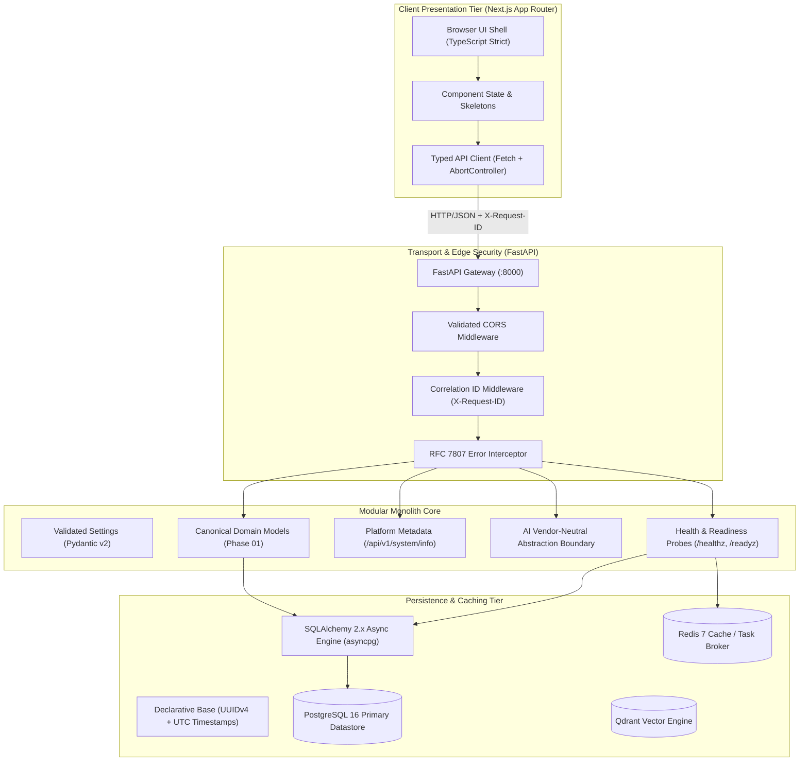
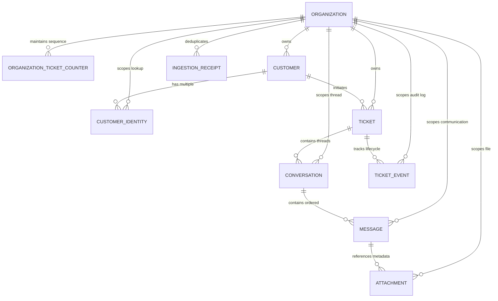

# SupportGPT AI — Architecture & Engineering Standards

## 1. System Mission & Scope
SupportGPT AI is an enterprise-grade multi-tenant B2B SaaS platform engineered for customer support automation with factual reliability, claim-level response verification, human-in-the-loop approvals, and forensic failure investigation.

Phase 00 established the greenfield technical foundation and architectural standards across the frontend, backend, database, and infrastructure tiers.
Phase 01 establishes the canonical customer support domain models, normalized schemas, composite tenant boundaries, and Alembic database migration foundation.

---

## 2. High-Level Architecture Diagram

---

## 3. Domain Model Architecture & Entity Relationship (Phase 01)

### 3.1 Domain Glossary
- **`Organization`**: Authoritative enterprise customer workspace and root multi-tenant boundary.
- **`OrganizationTicketCounter`**: Concurrency-safe atomic sequential counter table allocating per-organization ticket numbers.
- **`Customer`**: External person or business contacting customer support.
- **`CustomerIdentity`**: Specific contact handle (email, phone, channel identifier) owned by a customer, normalized for deduplication.
- **`Ticket`**: Canonical customer support case record tracking subject, lifecycle status, priority, and assignment.
- **`Conversation`**: Interactive communication thread within a ticket (e.g. email thread, live chat session).
- **`Message`**: Immutable individual communication entry within a conversation thread with deterministic chronological ordering.
- **`Attachment`**: Opaque file metadata reference attached to a message without storing file bytes in relational rows.
- **`TicketEvent`**: Append-only historical lifecycle audit record capturing state transitions, assignments, and mutations.
- **`IngestionReceipt`**: Inbound event idempotency record tracking external provider event IDs to prevent duplicate processing.

### 3.2 Entity Relationship Diagram

---

## 4. Key Integrity Rules & Database Invariants

### 4.1 Tenant-Boundary Composite Foreign Keys
To guarantee multi-tenant data consistency at the PostgreSQL engine level, child entities enforce composite foreign keys spanning both the parent ID and the `organization_id`:
1. `conversations` enforces `FOREIGN KEY (ticket_id, organization_id) REFERENCES tickets(id, organization_id)` on `RESTRICT`.
2. `messages` enforces `FOREIGN KEY (conversation_id, organization_id) REFERENCES conversations(id, organization_id)` on `RESTRICT`.
3. `attachments` enforces `FOREIGN KEY (message_id, organization_id) REFERENCES messages(id, organization_id)` on `RESTRICT`.
4. `ticket_events` enforces `FOREIGN KEY (ticket_id, organization_id) REFERENCES tickets(id, organization_id)` on `RESTRICT`.
5. `customer_identities` enforces `FOREIGN KEY (customer_id, organization_id) REFERENCES customers(id, organization_id)` on `CASCADE`.

**Impact**: It is physically impossible in the database for a conversation, message, attachment, or event to point to an entity in a different organization.

### 4.2 Deletion Safeguards (`ON DELETE RESTRICT`)
- Deleting an `Organization` with active customers, tickets, or audit events is blocked via `ON DELETE RESTRICT`. Historical records are safeguarded from accidental deletion.
- Deleting a `Customer` sets `tickets.customer_id = NULL` (`ON DELETE SET NULL`), preserving the ticket case history.
- `CustomerIdentity` records cascade on customer deletion (`ON DELETE CASCADE`) as they are components of the customer aggregate.

### 4.3 Ticket Number Generation Strategy
- Uses a dedicated transactional table: `organization_ticket_counters(organization_id, next_ticket_number)`.
- Allocated within transaction boundaries via `SELECT FOR UPDATE` with row-level locking.
- Prevents race conditions and guarantees gap-free, monotonically increasing ticket numbers per organization.

### 4.4 Idempotency & Deduplication
- `IngestionReceipt` enforces `UNIQUE (organization_id, source_provider, external_event_id)`. Duplicate webhook/email events from upstream providers are immediately recognized and deduplicated before downstream processing.
- `Message` indexes `(organization_id, external_message_id)` to prevent duplicate deliveries within the thread.

---

## 5. Lifecycle Statuses & Transition Rules

### Ticket Status Lifecycle
- Valid Statuses: `open`, `pending`, `in_progress`, `resolved`, `closed`
- Priorities: `urgent`, `high`, `medium`, `low`
- Channels: `email`, `chat`, `api`, `web`, `internal`
- Valid Transition Matrix:
  - `open` -> `pending`, `in_progress`, `resolved`, `closed`
  - `pending` -> `open`, `in_progress`, `resolved`, `closed`
  - `in_progress` -> `pending`, `resolved`, `closed`, `open`
  - `resolved` -> `open` (customer re-open), `closed`
  - `closed` -> `open` (authorized re-open)

---

---

## 6. Authentication, Organization Membership, RBAC & Tenant Isolation (Phase 02)

### 6.1 User & Identity Management
- **User Accounts (`users`)**:
  - UUIDv4 primary key (`id`).
  - Canonical normalized email address (`email`, lowercase, trimmed, unique index).
  - Argon2id password hash (`password_hash`, 64MB memory, 3 iterations, 4 parallelism).
  - Explicit account status (`status`: `active`, `suspended`, `disabled`).
  - Account audit timestamps (`created_at`, `updated_at`, `last_login_at`, `password_changed_at`).
  - Constant-time verification with dummy hash execution for non-existent users to eliminate timing side-channels and account enumeration.

### 6.2 Session Lifecycle & Token Security
- **User Sessions (`user_sessions`)**:
  - Server-side revocable session table indexed on SHA-256 token hashes (`session_token_hash`).
  - Raw session tokens are 256-bit cryptographically random strings (`secrets.token_urlsafe(32)`), transported via secure `HttpOnly`, `SameSite=Lax` cookies (`supportgpt_session`) or `Authorization: Bearer <token>` headers.
  - Immediate invalidation on logout (`/api/v1/auth/logout`) and automatic expiration after 7 days.
  - Raw session secrets and password hashes are never exposed in API responses or structured logs.

### 6.3 Multi-Tenant Organization Membership & Centralized RBAC
- **Organization Memberships (`organization_memberships`)**:
  - UUIDv4 primary key (`id`).
  - Explicit foreign keys to `organizations` (`ON DELETE RESTRICT`) and `users` (`ON DELETE CASCADE`).
  - Database-enforced uniqueness per `(organization_id, user_id)`.
  - Roles: `owner`, `admin`, `agent`, `viewer`.
  - Statuses: `active`, `suspended`, `invited`, `revoked`. Suspended or revoked memberships immediately deny access.
- **Role-Permission Matrix & Least Privilege**:
  - `owner`: Full organizational authority, member provisioning, ownership transfer.
  - `admin`: Member management (excluding owners), operational oversight of tickets and customers.
  - `agent`: Operational support actions (read/write tickets and customers, assign tickets).
  - `viewer`: Read-only access to organization, tickets, and customers.
- **Privilege Escalation & Last-Owner Protections**:
  - `admin` cannot grant `owner` or `admin` roles, preventing unauthorized escalation.
  - Demoting or revoking the sole active `owner` in an organization is blocked with `403 Forbidden`.

### 6.4 Tenant Authorization & PostgreSQL Row-Level Security (RLS)
- **Application Layer**:
  - `OrganizationContext` dependency verifies caller's active membership in the target organization.
  - `TenantScopedQuery` ensures all entity queries unconditionally filter by `WHERE organization_id = :org_id`. Cross-tenant lookups return `None` (resulting in `404 Not Found`), preventing existence disclosure.
- **Database Layer**:
  - PostgreSQL Row-Level Security (RLS) enabled with `FORCE ROW LEVEL SECURITY` across all multi-tenant tables (`tickets`, `conversations`, `messages`, `attachments`, `ticket_events`, `customers`, `customer_identities`).
  - Transaction-local tenant context established via `SELECT set_config('app.current_organization_id', :org_id, true)`. The `is_local=true` flag ensures immediate cleanup on transaction end, guaranteeing safe connection pool reuse.
  - Missing or unset context defaults to 0 rows returned and blocks all inserts.

---

## 7. Known Limitations & Deferred Work (Out of Scope for Phase 02)
1. **SSO / SAML / OAuth Social Providers**: Deferred to enterprise federation roadmap.
2. **Ingestion Pipelines**: Webhook endpoints, email MIME parsing, and background workers are scheduled for subsequent phases.
3. **File Storage**: `Attachment` models persist storage references (`storage_key`), not raw bytes. Object storage integrations (S3/GCS) and malware scanning will be integrated in future phases.
4. **Billing & Subscriptions**: Stripe/Paddle billing models and seat management are deferred to subsequent phases.

