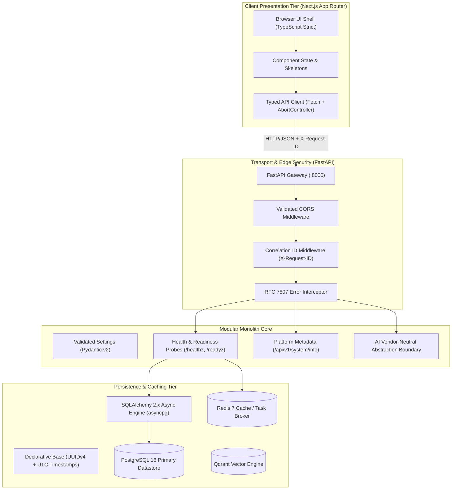
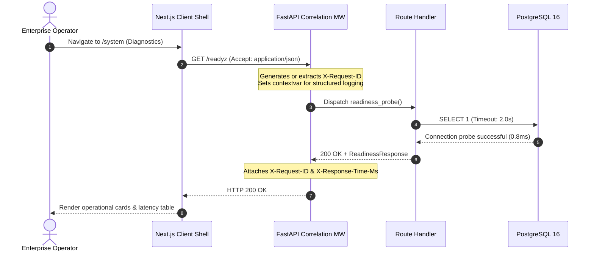

# SupportGPT AI — Architecture & Engineering Standards

## 1. System Mission & Scope
SupportGPT AI is an enterprise-grade multi-tenant B2B SaaS platform engineered for customer support automation with factual reliability, claim-level response verification, human-in-the-loop approvals, and forensic failure investigation.

Phase 00 establishes the greenfield technical foundation and architectural standards across the frontend, backend, database, and infrastructure tiers.

---

## 2. High-Level Architecture Diagram

---

## 3. Layer Boundaries & Component Responsibilities

| Layer | Directory | Responsibilities | Forbidden Patterns |
|---|---|---|---|
| **Transport** | `backend/app/api/` | HTTP request parsing, response status codes, route grouping. | No direct SQL queries, no business calculations. |
| **Core & Settings** | `backend/app/core/` | Configuration loading, production invariants, structured logging, correlation ID, error translation. | No credentials committed, no unredacted logs. |
| **Schemas** | `backend/app/schemas/` | Typed Pydantic request/response transfer objects. | No ORM models leaked directly without schema mapping. |
| **Domain Models** | `backend/app/models/` | SQLAlchemy 2.x declarative definitions, table constraints, indexes. | No business logic in model definitions. |
| **Database Session** | `backend/app/db/` | Async engine pool, session dependency injection, connection verification. | No unclosed sessions or uncontrolled transactions. |
| **AI Boundary** | `backend/app/ai/` | Vendor-neutral abstract base classes (`BaseLLMProvider`, `BaseEmbeddingProvider`), `AIActionProposal` invariants. | No hardcoded SDK calls, no AI action executed without proposal status. |
| **Frontend Shell** | `frontend/src/` | Next.js App Router, accessible design system, live diagnostic views, typed client. | No fake metrics, no simulated nonfunctional controls. |

---

## 4. End-to-End Request Flow

---

## 5. Architectural Standards Enforced
1. **Correlation Tracking**: Every HTTP request receives an `X-Request-ID` header (UUID4), which is propagated through all log records and error envelopes.
2. **Standardized Error Envelope**: API exceptions adhere to the RFC 7807 problem details specification without leaking stack traces or internal implementation paths.
3. **Database Conventions**:
   - Primary Keys: Non-sequential `UUIDv4`.
   - Timestamps: UTC-aware `created_at` and `updated_at`.
   - Naming Conventions: Deterministic metadata constraints (`ix_`, `uq_`, `ck_`, `fk_`, `pk_`).
4. **AI Safety Invariant**: All AI-generated actions are typed as `AIActionProposal` with immutable `is_proposal=True`. They require authenticated human approval or deterministic policy execution before mutation.
