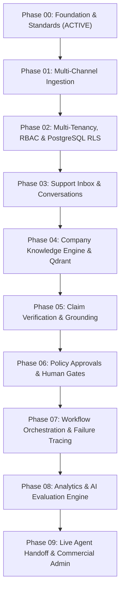

# SupportGPT AI — Phased Product Roadmap

## 1. Overview
SupportGPT AI is constructed sequentially through disciplined engineering phases. Each phase builds upon the verified architectural invariants of preceding phases. No feature is marked complete until real backend models, migrations, automated tests, and UI states exist.

---

## 2. Phase Breakdown & Execution Sequence

---

## 3. Phase Details & Deliverables

### Phase 00: Greenfield Product Foundation, Architecture & Engineering Standards
- **Status**: **COMPLETE / ACTIVE**
- **Core Deliverables**:
  - Modular Monolith architecture definition and directory hierarchy.
  - Pydantic v2 validated settings with production safety invariants.
  - FastAPI asynchronous transport with request correlation tracking (`X-Request-ID`) and RFC 7807 error handling.
  - PostgreSQL 16 schema conventions (UUIDv4 primary keys, UTC timestamps, deterministic constraint naming).
  - Alembic asynchronous migration pipeline.
  - Distinct liveness (`/healthz`) and readiness (`/readyz`) probe endpoints.
  - Vendor-neutral AI provider abstractions and `AIActionProposal` invariants.
  - Next.js App Router application shell with TypeScript strict mode, accessible Tailwind UI, and live system diagnostics.
  - Automated Pytest test suite, Ruff linting, and GitHub Actions CI workflow.

---

### Phase 01: Multi-Channel Data Ingestion Models & Ticket Foundations
- **Status**: Scheduled (Next Phase)
- **Dependencies**: Phase 00
- **Scope**:
  - Universal ticket and message schema definition.
  - Ingestion adapter interfaces (Email MIME parsing, Webhook payloads).
  - Normalization pipeline converting heterogeneous customer inquiries into canonical conversation models.

---

### Phase 02: Multi-Tenancy Architecture, Organizations, RBAC & PostgreSQL RLS
- **Status**: Scheduled
- **Dependencies**: Phase 00, Phase 01
- **Scope**:
  - Organization workspace entities and user membership schemas.
  - PostgreSQL Row-Level Security (RLS) enforcement via transaction-scoped `SET LOCAL app.current_tenant_id`.
  - JWT session token authentication and role-based access control (RBAC).
  - Adversarial tenant isolation test suite.

---

### Phase 03: Support Inbox, Persistent Conversations & State Management
- **Status**: Scheduled
- **Dependencies**: Phase 02
- **Scope**:
  - Real-time support inbox with conversation assignment, status transitions, and priority tagging.
  - Customer profile timeline and conversation thread persistence.

---

### Phase 04: Company Knowledge Engine, Chunking & Qdrant Retrieval
- **Status**: Scheduled
- **Dependencies**: Phase 02
- **Scope**:
  - Multi-format document ingestion (Markdown, PDF, HTML).
  - Chunking strategies and vector embedding generation.
  - Qdrant multi-tenant collection indexing and hybrid similarity retrieval.

---

### Phase 05: Claim-Level Response Verification & Hallucination Guard
- **Status**: Scheduled
- **Dependencies**: Phase 04
- **Scope**:
  - Decomposition of candidate AI responses into atomic factual claims.
  - Evidence retrieval and source-grounding verification against company knowledge.
  - Contradiction detection and automated blocking of ungrounded responses.

---

### Phase 06: Policy Enforcement & Human-in-the-Loop Approvals
- **Status**: Scheduled
- **Dependencies**: Phase 03, Phase 05
- **Scope**:
  - Policy decision engine identifying high-risk actions (e.g. refunds, cancellations, escalations).
  - Human agent approval interception workflow.
  - Immutable audit trail of agent approvals and rejections.

---

### Phase 07: Durable AI Workflow Orchestration & Forensic Failure Investigation
- **Status**: Scheduled
- **Dependencies**: Phase 05, Phase 06
- **Scope**:
  - Redis-backed durable workflow orchestration for asynchronous support tasks.
  - Forensic diagnostic tools tracing failure root causes (retrieval gaps, prompt drift, policy conflicts).

---

### Phase 08: Operational Analytics & Repeatable AI Evaluation
- **Status**: Scheduled
- **Dependencies**: Phase 07
- **Scope**:
  - Automated evaluation benchmarks on real support datasets.
  - Accuracy metrics, citation fidelity scoring, and latency analytics.

---

### Phase 09: Live Agent Handoff, Embeddable Chat Widget & Commercial Admin
- **Status**: Scheduled
- **Dependencies**: Phase 03, Phase 08
- **Scope**:
  - Embeddable customer chat widget.
  - Seamless real-time agent handoff with conversation context transfer.
  - Commercial subscription metering and billing administration.
