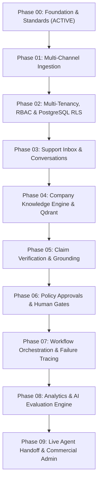

# SupportGPT AI — Phased Product Roadmap

## 1. Overview
SupportGPT AI is constructed sequentially through disciplined engineering phases. Each phase builds upon the verified architectural invariants of preceding phases. No feature is marked complete until real backend models, migrations, automated tests, and UI states exist.

---

## 2. Phase Breakdown & Execution Sequence

---

## 3. Phase Details & Deliverables

### Phase 00: Greenfield Product Foundation, Architecture & Engineering Standards
- **Status**: **COMPLETE / ACTIVE**
- **Core Deliverables**:
  - Modular Monolith architecture definition and directory hierarchy.
  - Pydantic v2 validated settings with production safety invariants.
  - FastAPI asynchronous transport with request correlation tracking (`X-Request-ID`) and RFC 7807 error handling.
  - PostgreSQL 16 schema conventions (UUIDv4 primary keys, UTC timestamps, deterministic constraint naming).
  - Alembic asynchronous migration pipeline.
  - Distinct liveness (`/healthz`) and readiness (`/readyz`) probe endpoints.
  - Vendor-neutral AI provider abstractions and `AIActionProposal` invariants.
  - Next.js App Router application shell with TypeScript strict mode, accessible Tailwind UI, and live system diagnostics.
  - Automated Pytest test suite, Ruff linting, and GitHub Actions CI workflow.

---

### Phase 01: Canonical Domain Model, PostgreSQL Persistence & Migration Foundation
- **Status**: **COMPLETE / VERIFIED**
- **Dependencies**: Phase 00
- **Scope & Deliverables**:
  - Canonical domain models: `Organization`, `OrganizationTicketCounter`, `Customer`, `CustomerIdentity`, `Ticket`, `Conversation`, `Message`, `Attachment`, `TicketEvent`, `IngestionReceipt`.
  - Database-enforced tenant boundaries via composite foreign keys spanning `(parent_id, organization_id)`.
  - Concurrency-safe atomic sequential ticket number allocation per organization via row-level locks.
  - Deletion safeguards with explicit `ON DELETE RESTRICT` preserving customer history.
  - Alembic migration `0002_canonical_domain_model` with verified reversible DDL.
  - Automated test suite covering slug/identity normalization, lifecycle integrity, unique constraints, and check constraints.

---

### Phase 02: Production-Oriented Authentication, Organization Membership, RBAC & Tenant Isolation
- **Status**: **COMPLETE / VERIFIED**
- **Dependencies**: Phase 00, Phase 01
- **Scope & Deliverables**:
  - Secure `User` account model with Argon2id cryptographic password hashing, strict email canonicalization, and account status controls.
  - Associative `OrganizationMembership` model supporting multi-org memberships per user, multi-user orgs, and unique relational constraints.
  - Server-side revocable `UserSession` tracking with SHA-256 token hashing, HttpOnly secure cookies, and optional Bearer token authorization.
  - Centralized Role-Based Access Control (RBAC) with explicit role-permission matrix (`owner`, `admin`, `agent`, `viewer`), least-privilege enforcement, privilege escalation guards, and last-owner protection.
  - Request-level `OrganizationContext` dependency and `TenantScopedQuery` repository abstraction ensuring strict tenant isolation.
  - Live PostgreSQL Row-Level Security (RLS) enforcement on all tenant tables (`tickets`, `conversations`, `messages`, `attachments`, `ticket_events`, `customers`, `customer_identities`) with transaction-local context (`set_config('app.current_organization_id', ..., true)`).
  - Alembic migration `0003_auth_membership_rbac` with verified upgrade and reversible downgrade.
  - Next.js `/login` interface connecting to the real backend with typed client methods and real-time validation.
  - Full automated test suite (60 tests passed, 0 failures, 1 optional container probe skipped).

---

### Phase 03: Ticket Management, Conversation Services, Message APIs & Business Logic
- **Status**: **COMPLETE / VERIFIED**
- **Dependencies**: Phase 00, Phase 01, Phase 02
- **Scope & Deliverables**:
  - Ticket management service with sequential atomic allocation (`allocate_next_ticket_number` row-level locking).
  - Optimistic Concurrency Control (OCC) via `lock_version` column on `tickets` with conflict handling (`409 Conflict`).
  - Domain-enforced lifecycle status transitions (`can_transition_ticket_status`) and assignment eligibility rules (rejecting viewers and non-members).
  - Conversation threads and message creation with deterministic sequence numbers (`(created_at ASC, sequence_number ASC, id ASC)`).
  - External delivery idempotency on `external_message_id` preventing duplicate communications.
  - Author role validation preventing ordinary agents from impersonating `system` or `ai` senders.
  - Attachment metadata retrieval with internal `storage_key` locator redaction.
  - Append-only transactional audit trail via `TicketEvent` with correlation ID linking.
  - Complete RESTful API endpoints for tickets, conversations, messages, attachments, and customers.
  - Alembic migration `0004_ticket_concurrency_version` with verified reversible upgrade and downgrade.
  - Real Next.js `/tickets` management console with live ticket listing, creation, conversation inspection, status transitions, and optimistic concurrency reloading.
  - Automated test suite (79 tests passed, 0 failures, 1 optional container probe skipped).

---

### Phase 04: Company Knowledge Engine, Chunking & Qdrant Retrieval
- **Status**: Scheduled
- **Dependencies**: Phase 02
- **Scope**:
  - Multi-format document ingestion (Markdown, PDF, HTML).
  - Chunking strategies and vector embedding generation.
  - Qdrant multi-tenant collection indexing and hybrid similarity retrieval.

---

### Phase 05: Claim-Level Response Verification & Hallucination Guard
- **Status**: Scheduled
- **Dependencies**: Phase 04
- **Scope**:
  - Decomposition of candidate AI responses into atomic factual claims.
  - Evidence retrieval and source-grounding verification against company knowledge.
  - Contradiction detection and automated blocking of ungrounded responses.

---

### Phase 06: Policy Enforcement & Human-in-the-Loop Approvals
- **Status**: Scheduled
- **Dependencies**: Phase 03, Phase 05
- **Scope**:
  - Policy decision engine identifying high-risk actions (e.g. refunds, cancellations, escalations).
  - Human agent approval interception workflow.
  - Immutable audit trail of agent approvals and rejections.

---

### Phase 07: Durable AI Workflow Orchestration & Forensic Failure Investigation
- **Status**: Scheduled
- **Dependencies**: Phase 05, Phase 06
- **Scope**:
  - Redis-backed durable workflow orchestration for asynchronous support tasks.
  - Forensic diagnostic tools tracing failure root causes (retrieval gaps, prompt drift, policy conflicts).

---

### Phase 08: Operational Analytics & Repeatable AI Evaluation
- **Status**: Scheduled
- **Dependencies**: Phase 07
- **Scope**:
  - Automated evaluation benchmarks on real support datasets.
  - Accuracy metrics, citation fidelity scoring, and latency analytics.

---

### Phase 09: Live Agent Handoff, Embeddable Chat Widget & Commercial Admin
- **Status**: Scheduled
- **Dependencies**: Phase 03, Phase 08
- **Scope**:
  - Embeddable customer chat widget.
  - Seamless real-time agent handoff with conversation context transfer.
  - Commercial subscription metering and billing administration.
