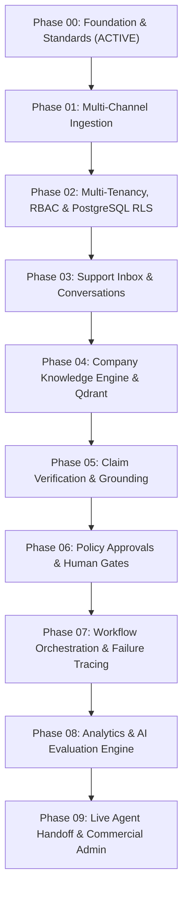

# SupportGPT AI — Phased Product Roadmap

## 1. Overview
SupportGPT AI is constructed sequentially through disciplined engineering phases. Each phase builds upon the verified architectural invariants of preceding phases. No feature is marked complete until real backend models, migrations, automated tests, and UI states exist.

---

## 2. Phase Breakdown & Execution Sequence

---

## 3. Phase Details & Deliverables

### Phase 00: Greenfield Product Foundation, Architecture & Engineering Standards
- **Status**: **COMPLETE / ACTIVE**
- **Core Deliverables**:
  - Modular Monolith architecture definition and directory hierarchy.
  - Pydantic v2 validated settings with production safety invariants.
  - FastAPI asynchronous transport with request correlation tracking (`X-Request-ID`) and RFC 7807 error handling.
  - PostgreSQL 16 schema conventions (UUIDv4 primary keys, UTC timestamps, deterministic constraint naming).
  - Alembic asynchronous migration pipeline.
  - Distinct liveness (`/healthz`) and readiness (`/readyz`) probe endpoints.
  - Vendor-neutral AI provider abstractions and `AIActionProposal` invariants.
  - Next.js App Router application shell with TypeScript strict mode, accessible Tailwind UI, and live system diagnostics.
  - Automated Pytest test suite, Ruff linting, and GitHub Actions CI workflow.

---

### Phase 01: Canonical Domain Model, PostgreSQL Persistence & Migration Foundation
- **Status**: **COMPLETE / VERIFIED**
- **Dependencies**: Phase 00
- **Scope & Deliverables**:
  - Canonical domain models: `Organization`, `OrganizationTicketCounter`, `Customer`, `CustomerIdentity`, `Ticket`, `Conversation`, `Message`, `Attachment`, `TicketEvent`, `IngestionReceipt`.
  - Database-enforced tenant boundaries via composite foreign keys spanning `(parent_id, organization_id)`.
  - Concurrency-safe atomic sequential ticket number allocation per organization via row-level locks.
  - Deletion safeguards with explicit `ON DELETE RESTRICT` preserving customer history.
  - Alembic migration `0002_canonical_domain_model` with verified reversible DDL.
  - Automated test suite covering slug/identity normalization, lifecycle integrity, unique constraints, and check constraints.

---

### Phase 02: Production-Oriented Authentication, Organization Membership, RBAC & Tenant Isolation
- **Status**: **COMPLETE / VERIFIED**
- **Dependencies**: Phase 00, Phase 01
- **Scope & Deliverables**:
  - Secure `User` account model with Argon2id cryptographic password hashing, strict email canonicalization, and account status controls.
  - Associative `OrganizationMembership` model supporting multi-org memberships per user, multi-user orgs, and unique relational constraints.
  - Server-side revocable `UserSession` tracking with SHA-256 token hashing, HttpOnly secure cookies, and optional Bearer token authorization.
  - Centralized Role-Based Access Control (RBAC) with explicit role-permission matrix (`owner`, `admin`, `agent`, `viewer`), least-privilege enforcement, privilege escalation guards, and last-owner protection.
  - Request-level `OrganizationContext` dependency and `TenantScopedQuery` repository abstraction ensuring strict tenant isolation.
  - Live PostgreSQL Row-Level Security (RLS) enforcement on all tenant tables (`tickets`, `conversations`, `messages`, `attachments`, `ticket_events`, `customers`, `customer_identities`) with transaction-local context (`set_config('app.current_organization_id', ..., true)`).
  - Alembic migration `0003_auth_membership_rbac` with verified upgrade and reversible downgrade.
  - Next.js `/login` interface connecting to the real backend with typed client methods and real-time validation.
  - Full automated test suite (60 tests passed, 0 failures, 1 optional container probe skipped).

---

### Phase 03: Ticket Management, Conversation Services, Message APIs & Business Logic
- **Status**: **COMPLETE / VERIFIED**
- **Dependencies**: Phase 00, Phase 01, Phase 02
- **Scope & Deliverables**:
  - Ticket management service with sequential atomic allocation (`allocate_next_ticket_number` row-level locking).
  - Optimistic Concurrency Control (OCC) via `lock_version` column on `tickets` with conflict handling (`409 Conflict`).
  - Domain-enforced lifecycle status transitions (`can_transition_ticket_status`) and assignment eligibility rules (rejecting viewers and non-members).
  - Conversation threads and message creation with deterministic sequence numbers (`(created_at ASC, sequence_number ASC, id ASC)`).
  - External delivery idempotency on `external_message_id` preventing duplicate communications.
  - Author role validation preventing ordinary agents from impersonating `system` or `ai` senders.
  - Attachment metadata retrieval with internal `storage_key` locator redaction.
  - Append-only transactional audit trail via `TicketEvent` with correlation ID linking.
  - Complete RESTful API endpoints for tickets, conversations, messages, attachments, and customers.
  - Alembic migration `0004_ticket_concurrency_version` with verified reversible upgrade and downgrade.
  - Real Next.js `/tickets` management console with live ticket listing, creation, conversation inspection, status transitions, and optimistic concurrency reloading.
  - Automated test suite (79 tests passed, 0 failures, 1 optional container probe skipped).

---

### Phase 04: Reliable Event Ingestion, Webhooks, Idempotency, Background Processing & Connector Foundation
- **Status**: **COMPLETE / VERIFIED**
- **Dependencies**: Phase 00, Phase 01, Phase 02, Phase 03
- **Scope & Deliverables**:
  - Organization-scoped external source configuration (`EventSource`) with secure secret generation, cryptographic hash indexing, preview masking, and symmetric AES-CTR encryption at rest.
  - Inbound webhook reception boundary (`POST /api/v1/webhooks/sources/{id}` and `/api/v1/webhooks/generic`) verifying constant-time HMAC-SHA256 signatures, timestamp replay window (300s), payload size limits (1MB), and content-type validation.
  - Durable PostgreSQL-backed event receipts (`IngestionReceipt`) tracking lifecycle states (`queued`, `processing`, `processed`, `retry_wait`, `dead_letter`, `quarantined`) with engine-level deduplication on `(organization_id, source_provider, external_event_id)` and payload digest comparison (202 Accepted on new events, 200 OK on duplicate delivery, 409 Conflict on payload mismatch).
  - Background asynchronous worker (`IngestionWorker`) executing transactional job claiming with PostgreSQL `FOR UPDATE SKIP LOCKED`, crash recovery via expired lease reclamation, exponential backoff with jitter on retries, and dead-letter transitions.
  - Canonical event normalization pipeline (`CanonicalEvent`, `EventNormalizer`, `StandardWebhookAdapter`) validating incoming payloads with typed Pydantic models.
  - Idempotent domain mapping (`IngestionProcessor`) mapping normalized events to Phase 03 `Customer`, `Ticket`, `Conversation`, and `Message` models.
  - Operational APIs for authorized operators (`ingestion:read`, `ingestion:manage`) to query receipts with filters, retrieve sanitized details, and replay dead-lettered events without creating duplicate domain entities.
  - Worker health diagnostics endpoint (`GET /api/v1/ingestion/worker/health`).
  - Alembic migration `0005_event_ingestion_subsystem` applied and verified.
  - Automated test suite (122 tests passed, 0 failures, 1 optional container probe skipped).

---

### Phase 05: Enterprise Knowledge Base, Document Processing, Versioning & Retrieval Foundation
- **Status**: **COMPLETE / VERIFIED**
- **Dependencies**: Phase 00, Phase 01, Phase 02, Phase 03, Phase 04
- **Scope & Deliverables**:
  - Canonical knowledge domain models: `KnowledgeBase`, `Document`, `DocumentVersion`, `DocumentChunk`.
  - Object storage subsystem (`StorageBackend`, `LocalStorageBackend`) with path traversal guards, opaque non-guessable storage keys, atomic streaming writes, and checksum verification.
  - Strict file validation policy (`validate_document_file`): format allowlist (PDF, DOCX, TXT, Markdown), magic byte inspection (`%PDF-`, PKZIP OpenXML), zip bomb defense (100MB limit, 50x expansion ratio), and binary null byte rejection.
  - Real text extractors: `PdfExtractor` (`pypdf` with scanned/image-only PDF detection and `OCR_UNAVAILABLE` reporting), `DocxExtractor` (`python-docx` with heading styles and tabular data preservation), and `TextExtractor` (UTF-8/UTF-8-SIG line ending normalization).
  - Deterministic text normalization (`TextNormalizer`) preserving URLs, code blocks, and section headings.
  - Reproducible hierarchical structural chunking (`HierarchicalStructuralChunker`): heading hierarchy tracking, exact start/end character offsets, word/char counts, chunk SHA-256 checksums, and zero empty chunks.
  - Background document processing worker (`DocumentWorker`) with PostgreSQL `FOR UPDATE SKIP LOCKED` claiming, expired lease reclamation (300s timeout), exponential retry backoff, and prior version preservation (failed new version processing preserves previous usable version).
  - PostgreSQL 16 migration `0006_knowledge_base_subsystem` applied to both `supportgpt_db` and `supportgpt_test_db` with live Row-Level Security (RLS) policies and composite tenant foreign key constraints.
  - Organization-scoped RESTful API endpoints for knowledge base CRUD, document uploads, revisions, reprocessing, soft delete, and chunk retrieval with RBAC enforcement.
  - Automated test suite (160 tests passed, 0 failures, 1 optional container probe skipped).

---

### Phase 06: Evidence-Grounded Retrieval & Answering Foundation
- **Status**: **COMPLETE / VERIFIED**
- **Dependencies**: Phase 02, Phase 05
- **Scope & Deliverables**:
  - Dense semantic vector embeddings via `EmbeddingProvider` abstraction (`FastEmbedEmbeddingProvider` with `BAAI/bge-small-en-v1.5` 384 dims running via ONNX Runtime, plus `OpenAIEmbeddingProvider`).
  - Strict vector validation verifying dimensional compatibility and finite float values (`math.isfinite`), actively rejecting non-finite and NaN vectors.
  - Qdrant vector store manager (`QdrantStoreManager`) with deterministic UUIDv5 point identities, collection parameter drift detection, minimal indexing payloads, and local in-memory fallback for offline test environments.
  - Durable background indexing integrated into `DocumentWorker`, advancing versions to `INDEXED` only upon verified vector upsert and safely preserving prior usable versions on error.
  - Soft-deletion vector de-indexing in Qdrant upon document archiving/deletion.
  - Dedicated `RetrievalService` supporting query validation, dense vector search, lexical PostgreSQL search (`tsvector`), Reciprocal Rank Fusion (RRF), and authoritative PostgreSQL Row-Level Security verification.
  - Dual-layer tenant isolation: server-enforced Qdrant payload filters AND authoritative PostgreSQL post-retrieval cross-checks.
  - Grounded answer generation (`GroundedAnswerService`) with prompt-injection defense (`<evidence>` XML boundaries, passive data directives), verified citation resolution (`[citation:N]`), and automated abstention (`NO_RELEVANT_EVIDENCE`, `EVIDENCE_INSUFFICIENT`).
  - Next.js frontend interactive search and Q&A interface at `/knowledge` with collection filtering, citation drawers, and loading/error states.
  - Automated evaluation framework (`RAGEvaluator`) measuring Recall@k, Mean Reciprocal Rank (MRR), citation validity rate, and abstention accuracy against an explicitly labeled dataset.
  - 100% automated test coverage (unit, API, tenant isolation, and live PostgreSQL integration tests).

---

### Phase 07: Response Verification & Claim-Level Fact Checking
- **Status**: Scheduled
- **Dependencies**: Phase 05, Phase 06
- **Scope**:
  - Automated decomposition of model completions into atomic verifiable claims.
  - Strict claim-level NLI contradiction detection and evidence grounding verification.
  - Hallucination suppression before draft or response delivery.

---

### Phase 08: Policy Enforcement & Human-in-the-Loop Approvals
- **Status**: Scheduled
- **Dependencies**: Phase 03, Phase 07
- **Scope**:
  - Policy decision engine identifying high-risk actions (e.g. refunds, cancellations, escalations).
  - Human agent approval interception workflow and review queues.
  - Immutable audit trail of agent approvals and rejections.

---

### Phase 09: Durable AI Workflow Orchestration & Forensic Failure Investigation
- **Status**: Scheduled
- **Dependencies**: Phase 06, Phase 08
- **Scope**:
  - Redis-backed durable workflow orchestration for asynchronous support tasks.
  - Forensic diagnostic tools tracing failure root causes (retrieval gaps, prompt drift, policy conflicts).

---

### Phase 10: Operational Analytics & Repeatable AI Evaluation
- **Status**: Scheduled
- **Dependencies**: Phase 09
- **Scope**:
  - Production evaluation benchmarks on live support datasets.
  - Accuracy metrics, citation fidelity scoring, latency analytics, and drift monitoring.

---

### Phase 11: Live Agent Handoff, Embeddable Chat Widget & Commercial Admin
- **Status**: Scheduled
- **Dependencies**: Phase 03, Phase 10
- **Scope**:
  - Embeddable customer chat widget with real-time streaming.
  - Seamless real-time agent handoff with conversation context transfer.
  - Commercial subscription metering and billing administration.
